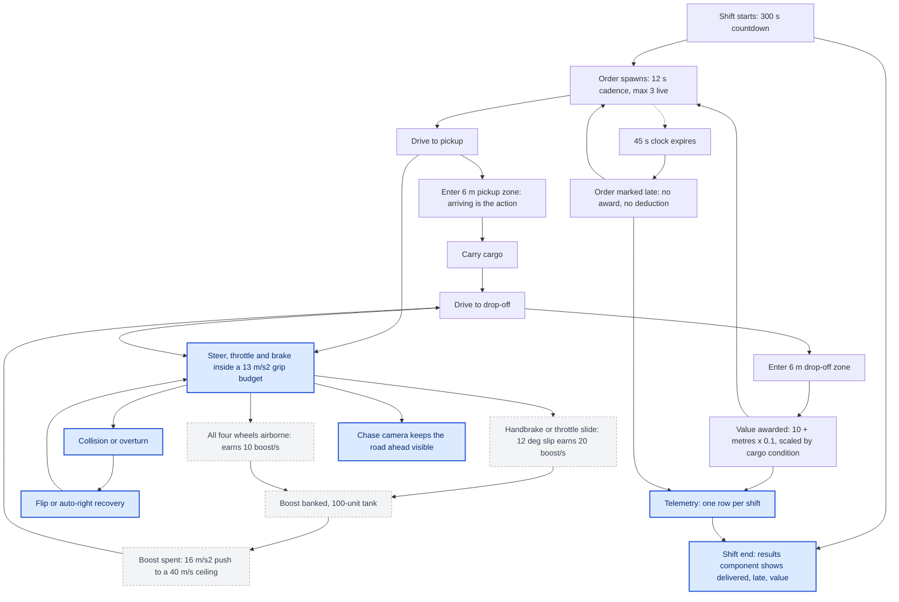
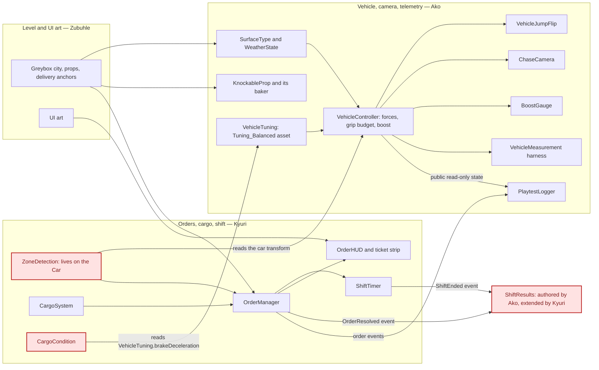
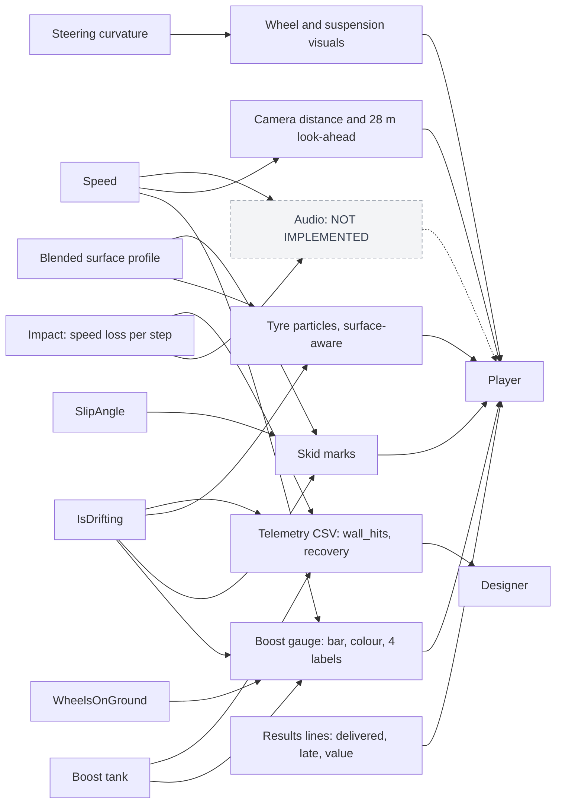

# Milestone 2 — Individual Documentation

**Module:** DIGA3002A · **Group:** 15 · **Project:** Zoom Zoom Delivery Co.
**Author:** Ako Baloyi
**Area of contribution:** vehicle physics and tuning · chase camera · telemetry (`PlaytestLogger`
runtime logger, `VehicleMeasurement` in-editor harness) · surface traction and weather · knockable
street props and their editor baker · boost, jump and flip · the boost gauge · the end-of-shift
results component · shared-build integration
**Tree described:** `feature/vehicle-camera` @ `618f2be`. Where `origin/main` differs it is named.
**Authority:** where this document and `docs/DESIGN-OVERVIEW.md` could disagree, that document wins;
its §6a records twelve claims it demoted, and the corrections are carried here.

---

## 0. Executive summary

**What changed since Milestone 1.** From the commit record after the 23 September M1 deadline, READ
via `git log --follow`: chase-camera wall avoidance (`311cdc8`); the end-of-shift results component
(`7788db4`); earned boost and its gauge (`a3a1351`, fixed `e0bcf89`); `PlaytestLogger` and its
session sheet (`ca9a463`); knockable props and their baker (seven commits, 13 Oct); surface tagging
with `WeatherState` and `ApplyWeather` (`457d1f3`, `c03c220`); and the ignore rules that ended a
recurring disk-filling failure (`618f2be`).

**What the player can do now.** Slide or leave the ground to bank boost and spend it for a measured
40.1278 m/s push against a 32 m/s throttle ceiling (MEASURED, `vehicle_measurements.csv`, `Boost`
rows, `2026-10-07 13:56:45`). Drive a city whose surfaces can differ under the wheels. Knock 33
street props aside in `Hard`. Corner without the camera clipping geometry. Finish a shift and read
what it was worth. One qualification belongs here, not lower down. **The boost economy has never
been exercised in logged play:** `boost_activations`, `boost_seconds`, `boost_earned` and
`handbrake_seconds` are 0 in all seven `playtest_sessions.csv` rows (MEASURED).

**What is still broken.** (a) The Tarmac tag sits on a `MeshCollider` whose `m_Mesh` is
`{fileID: 0}`, so the drivable area resolves to the untagged default. (b) The chase camera has no
reverse case, aiming 28 m in front of the car while reversing. (c) Both `PlaytestLogger` time
fields are corrupt: `shift_seconds` writes 0 on the early-exit path, and the shift-log rows behind
session S01 carry `play_seconds` 0.0. Both are `PlaytestLogs/shift_log.csv` fields, not columns of
`playtest_sessions.csv`; the sheet quotes them inside `observer_notes` ("Logged play_seconds=0.0;
shift_seconds=11"). (d) `Easy.unity` is in no `EditorBuildSettings.asset` on either tree. (e) There
is no audio anywhere in the project.

## 0.1 Rubric map

| Criterion | Where it is answered | Primary evidence |
| --- | --- | --- |
| 1. Macro-level design documentation (15) | §1 Macro-level design: the shift, the loop, and what the vehicle work changed | `notes-vehicle.md` §1–§5; `turning-geometry-2026-10-14/report.md` §3–§4; `M2-PLAYTEST-WRITEUP.md` §4.1, §4.7 |
| 2. Updated feature and communication design documentation (10) | §2 Updated feature and communication design documentation | `docs/M1-GEMINI-PROMPT-PACK.md:571,573` as the M1 baseline; `SurfaceType.cs`, `SurfaceTagger.cs`, `KnockablePropBaker.cs`, `BoostGauge.cs`, `PlaytestLogger.cs` |
| 3. Reflection documentation (5) | The reflection itself is written by the author; its working material is `docs/M2-REFLECTION-SCAFFOLD.md`, which is not submission text. §3 here is a pointer only | Commit chain of 13 Oct 2026; the `.gitignore` incident record; `playtest_sessions.csv` `session_type` |
| 4. Contribution and expression of intent (10) | §4 Contribution, integration and intent | `git shortlog -sn --all`; per-file `git log --follow`; `README.md` ownership tables; `docs/GIT-RULES.md` |

## 0.2 Scope: the systems this document claims

Claimed: vehicle physics and tuning; the chase camera; telemetry, meaning both the `PlaytestLogger`
runtime logger and the `VehicleMeasurement` in-editor harness; surface traction and weather;
knockable street props and their editor baker; boost, jump and flip; the boost gauge; the
end-of-shift results component; and shared-build integration, meaning the git rules, Git LFS
routing, merge discipline and the Python verification tooling.

Not claimed. Orders, shift timers, cargo, the order HUD and ticket strip, the results *panel*, the
difficulty scenes and the main menu are Kyuri Reddy's. The greybox level and the UI art are Zubuhle
Nel's. One file is shared: `ShiftResults.cs` was authored here (`7788db4`) and later extended by
Kyuri with level progression (`7022448`), so on `origin/main` it is joint work.

---

## 1. Macro-level design: the shift, the loop, and what the vehicle work changed

### 1.1 The unit of play is the 300-second shift

The whole game is one countdown. `ShiftTimer.shiftDurationSeconds` is `300f`, commented
`// 5 minutes, per Scope` (READ, `ShiftTimer.cs:19`), and serializes as 300 in all four gameplay
scenes (READ, `origin/main` `Hard:2301`, `Medium:54336`, `Easy:5568`, `Possible game scene:1713`).
All four of those line numbers are reads of `origin/main`: `Hard.unity`, `Medium.unity` and
`Easy.unity` do not exist on the described tree, where the equivalent scene is
`Assets/Project/Scenes/Kyuri's Scene.unity`. Every Easy/Medium/Hard scene read in this document is an
`origin/main` read on that basis.
Nothing checks a quota, a score threshold, a life count or a damage total: a shift can be finished
with a low number on it, but it cannot be failed (READ, `notes-orders.md` §4.1).

Orders arrive on a 12-second cadence with at most three live (READ, `OrderTuning.cs:24` and `:27`
for the live values; `OrderTuning_Balanced.asset:31-32` carries the same two figures but sits below
the YAML break described next, so the asset keys are not what the runtime reads), each carrying a
45-second clock that starts at spawn rather
than at pickup, so the drive *to* the pickup is already inside the budget. The live figure is 45 s,
not the 50 s the asset appears to specify: a `whyThisSetup` block sits at column 1 in
`OrderTuning_Balanced.asset`, which closes the YAML mapping and strands every key below it,
including `orderTimeLimit: 50`. The shipped binary holds `45.0`, the only field after the break whose
C# default differs from its asset value (READ, `OrderTuning.cs:31`; MEASURED, build binary at
`sharedassets1.assets` offset 113113600+8; `notes-friction.md` §1.1–§1.2).

That 45 s is the frame everything in this area has to fit. Against it, the costed route distribution
for the logged scene gives a median job of 541 m, a longest of 954 m, and 35 of 36 pairs clearing
45 s at the project's 20 m/s working average (MEASURED, `scene_physics.py jobs`, `notes-map.md`
§6.2). That working average is a constant in `delivery_points.py:49`, not a lap time, and has not
been re-based, so every second derived from it inherits the assumption.

### Figure 1 — Core gameplay loop, with this author's contributions marked



Solid blue nodes belong to this area of contribution and have been exercised in logged play. The
dashed grey chain — slide, air, bank, spend — also belongs to it, is measured working under the
harness, and has never fired in a logged shift. §4.4 gives the evidence and the reading.

### 1.2 What the vehicle work changed about the loop, across the whole playtime

**The limiter is corner speed and arrival, not top speed.** The car's asset top speed is 32 m/s
(READ, `Tuning_Balanced.asset`); the nearest driven evidence is 31.3653 m/s reached in 3.75 s
(MEASURED, `Stopping distance` rows). Steering is commanded as a curvature derived from the grip
budget, so the car is steering-limited below 29.1 m/s and grip-limited above it (DERIVED,
`VehicleTuning.cs:719-741`, crossover where overdrive reaches 1). No logged run has approached that
crossover, so the regime a player meets across five minutes is the steering-limited one: predictable,
and bounded by how fast they dare take a corner.

**Recovery is a player action, not a rescue.** A flip displaces the car 4.4439 m over 0.4583 s
against 4.6895 m of simply driving, logged as `Flip is not a shortcut = 1 (PASS)` (MEASURED, `Flip`
rows). A governor caps the gain at 3 m/s and removes it entirely above 12 m/s (READ,
`VehicleTuning.cs:481,486`; enforced `VehicleJumpFlip.cs:268-282`), and a flip earns no boost,
because a recovery move that refuels the car is a loop and not a recovery (READ,
`VehicleController.cs:903-908`). Wall recovery from 19.9 m/s totals 1.7583 s (MEASURED, `Wall
recovery` rows). Recovery costs time and returns no advantage, which is what makes its cost legible.

**Progression inside a shift is skill, not unlocks.** Delivery value is
`(baseDeliveryValue + straightLineMetres × valuePerMetre) × clamp01(cargoCondition)`, shipping as
`(10 + 0.1 × metres) × condition` (READ, `OrderManager.cs:298`, `OrderTuning.cs:48-50`). A late order
awards nothing and deducts nothing; `latePenaltyPerSecond` has no reader, and
`PlayerProgression.TrySpendMoney` has no caller, so nothing can be bought (READ, `notes-orders.md`
§3.2, §3.6). Across five minutes the only thing that compounds is the player's knowledge of the city
and of the car — which makes a handling model that can be learned the entire progression curve.

### Figure 2 — System integration: the vehicle, camera and telemetry boundary



The dependency directions are read from code rather than idealised. Three crossings sit on the
boundary, marked red. `ZoneDetection` lives on the Car but belongs to the order system and reads the
vehicle's transform (READ, `ZoneDetection.cs`; recorded in `README.md`). `CargoCondition` reads
`vehicle.Tuning.brakeDeceleration` each time it tests a stop (READ, `CargoCondition.cs:91-92`) and
falls back to a hard-brake threshold of `27f` when no controller is found, which is exactly the
brake-plus-coast figure the measurements produce (READ, `CargoCondition.cs:60`). `ShiftResults`
listens to `OrderResolved` and `ShiftEnded`. The direction that matters is the absent one: **the
vehicle never calls into the order system.** `PlaytestLogger` subscribes to order events, reads the
vehicle's public state and changes nothing it observes (READ, `PlaytestLogger.cs`). That one-way rule
is why the handling could be re-tuned repeatedly without breaking a teammate's system.

### 1.3 Micro to macro: one tuning field reaching a shift-level outcome

One example runs from a single serialized number to whether a delivery lands. The friction circle
takes longitudinal tyre work out of the lateral budget of the rear axle only, because the rear is the
driven axle (READ, `VehicleController.cs:1078-1082`). Coasting already spends 5 of a 16 m/s²
longitudinal reference, so brake input at or above roughly half travel saturates the circle and
strips the rear from 10.92 to 2.18 m/s², taking effective lateral grip from 12.78 to 8.63 m/s² and
widening the achievable corner by about 11 % at 10 m/s and 32 % at 20 m/s (DERIVED,
`turning-geometry` report §3.4, from `gripBalance` 0.58, `frictionCircleStrength` 0.8 and
`longitudinalGripReference` 16). Because the loss is rear-only it swings the tail rather than pushing
the nose wide, and past 12° of slip above 4 m/s the car is flagged `IsDrifting` and steering
authority drops to 55 % (READ, `VehicleController.cs:681-683, 991-993`).

The macro consequence is that braking into a drop-off is the manoeuvre most likely to cost a
delivery — a shift-level outcome produced by one tuning field. Whether players hit it is UNKNOWN:
nothing in the telemetry distinguishes a braking slide from any other, and the settling check would
be a logged brake-phase slip angle, which no column records.

> **SCREENSHOT PLACEHOLDER — NOT CAPTURED.** Boost gauge in its four authored states: earning from
> drift, earning from air, spending, and empty with the "drift or jump to earn" prompt. Capture in
> `VehicleLab` so the state can be forced. Place beside §2.2.

> **SCREENSHOT PLACEHOLDER — NOT CAPTURED.** The chase camera at a building corner with wall
> avoidance active, showing the camera held outside geometry rather than clipping through it.
> Capture in `Hard`. Place beside §2.5.

> **SCREENSHOT PLACEHOLDER — NOT CAPTURED.** The end-of-shift results panel at the whistle, showing
> the delivered, late and value lines. Place beside §2.7.

---

## 2. Updated feature and communication design documentation

### 2.1 What Milestone 1 documented, and what this expands

The M1 baseline for these two documentation criteria is recorded in
`docs/M1-GEMINI-PROMPT-PACK.md:571` (Micro-level/Feature) and `:573` (Communication Design). Both
that file and `docs/M1-INDIVIDUAL-GDD-AGENT-PROMPT.md` are **git-ignored working material** — named
in `.gitignore` as AI prompts and rubric notes rather than submission material — so they are cited by
path and a marker should not expect to open them from a clone. The submitted M1 Individual GDD is not
in the repository.

| Area | At M1, 23 Sep 2026 | Now | Source pair |
| --- | --- | --- | --- |
| Measurement sheet | 338 rows | 640 data rows, 641 lines with the header, all `Balanced` | `M1-GEMINI-PROMPT-PACK.md:571` / MEASURED line count of `VehicleLab_Measurements/vehicle_measurements.csv` |
| Delivery points | none assigned; `OrderManager` fell back to a six-pair ring | 12 hand-placed anchors wired in all four gameplay scenes | `M1-INDIVIDUAL-GDD-AGENT-PROMPT.md` / READ, `notes-orders.md` §3.4 (`PGS:1665-1678`, `Hard:2253-2266`) |
| Boost | in the tuning asset with no earn path shown to the player | earned only from drift at 20/s and air at 10/s, `boostRechargeRate` 0, four gauge states authored | `a3a1351`, `e0bcf89` / READ, `notes-vehicle.md` §5 |
| Camera | cast no rays and could clip into geometry | wall avoidance with `cameraCollisionRadius` 0.4 and `cameraCollisionRecoverTime` 0.35 | `311cdc8` / READ, `Tuning_Balanced.asset` |
| Surfaces | enum and profiles existed, nothing tagged | 84 tags in `Hard`; `WeatherState` and `ApplyWeather` added | `3c52f6b` / `457d1f3`, `c03c220`, MEASURED `notes-map.md` §4.6 |
| Props | none | 33 knockables in `Hard` only, four families, editor baker with an undo path | `a4b6649`…`c03c220` / MEASURED `notes-map.md` §5.1 |
| Telemetry of play | none | one row per shift to `PlaytestLogs/shift_log.csv`, 15 columns | `ca9a463` / READ, `PlaytestLogger.cs:90-94` |
| Editor tooling | 4 team-authored editor tools | same 4, two of them new this milestone | READ, `Assets/Project/Scripts/Vehicle/Editor/` |

On the last row: `compile_check.py` reports 5 editor scripts, but one is
`Assets/TutorialInfo/Scripts/Editor/ReadmeEditor.cs`, a Unity template leftover. The four
team-authored tools are `KnockablePropBaker`, `SurfaceTagger`, `VehicleAssetBaker` and
`VehicleLabSceneBuilder`; the first two are new this milestone.

### 2.2 Earned boost

Boost is a 100-unit tank spent at 33.3 units/s, giving a measured 3.0083 s of continuous push
against a derived 3.00 s (MEASURED and DERIVED, `Boost` rows and 100 ÷ 33.3). It accelerates at
16 m/s² on top of drive, grounded or airborne, to a 40 m/s ceiling, and the harness records a peak
of 40.1278 m/s — momentum carries the last 0.13 past the ceiling (MEASURED). `boostRechargeRate` is
0 on all three profiles and the recharge branch is gated on `> 0f`, so it never runs (READ,
`VehicleController.cs:885`).

Boost is **earned, not regenerated and not a pickup** — 20 units/s drifting, 10 airborne, 0 during a
flip — and each of those numbers has its reason recorded in the field that implements it.
`boostRechargeRate` was 12 and was set to 0 because a self-refilling tank collapses into holding
boost on every straight, which contains no decision; at 0, the tooltip states, boost becomes the
payout for driving well, which is the design question expressed in one mechanic (READ,
`VehicleTuning.cs:203-210`). 20 units/s makes a committed slide through a junction, about 1.5 s,
return roughly one second of boost, the stated intent being to give the handbrake a reason rather
than a novelty (READ, `:217-223`). Air pays half, because jumping is free apart from a cooldown and
an equal rate would make bouncing down a straight the efficient refill (READ, `:226-234`). A flip
pays nothing because a recovery move that refuels the car is a loop, not a recovery (READ,
`VehicleController.cs:903-908`). Measurement confirms the drift rate independently of the asset: a
2.5 s handbrake slide at 10 m/s counted as drifting for 1.875 s and paid 37.5 units, exactly
1.875 × 20 (MEASURED and DERIVED, `2026-10-07 13:56:50`).

One correction to this project's own `README.md`, which says a handbrake slide pays in. The earn
condition is the controller's `IsDrifting` — grounded, at least 4 m/s, slip angle at least 12° — and
nothing in the earn path reads the handbrake (READ, `VehicleController.cs:677-683, 910-920`). The
handbrake is one way to reach that state; a throttle-induced slide pays identically. The code is
right and the README's wording is looser than the code.

### 2.3 Surface traction and weather

`SurfaceKind` is `{Tarmac, Wet, Dirt, Grass, Ice, Metal, Concrete}`, resolved through the wheel
raycast's own hit with `GetComponentInParent`, so tagging a parent covers its children. An untagged
collider returns `SurfaceProfile.Default`, numerically identical to Tarmac, so untagged ground drives
exactly as the car did before surfaces existed (READ, `SurfaceType.cs:10-21`, `:113-131`).

**`Concrete` was appended, never inserted.** Scenes store enum values as integers, so inserting a
kind would renumber every serialized value, including the 640 measurement rows; the enum carries a
comment saying so. Concrete sits at 0.92 grip, a step *down* from tarmac, so cutting across a
forecourt loosens the car rather than rewarding leaving the road (READ, `SurfaceType.cs:236-245` —
the rationale comment runs from `:237`, the value `gripMultiplier = 0.92f` is at `:245`).

**Weather is one global enum applied once, after the four-wheel blend.** Grip, drive, brake, rolling
resistance and the visual fields are averaged across grounded wheels only, then `ApplyWeather` runs
once on the blend (READ, `VehicleController.cs:566-621`). `WeatherKind` is `{Dry, Rain, Snow, Ice}`;
`WeatherState.Current` returns `Dry` with no instance in the scene (READ, `WeatherState.cs:34-35`)
and `Dry` falls through `ApplyWeather` to `default: return ground;`, returning the profile unchanged,
so every lab measurement still describes the shipped car (READ, `SurfaceType.cs:317-318`). The
alternative was a per-surface wetness flag, which would have meant editing roughly 600 tagged
objects to change the weather. Averaging over wheels is itself a choice
over "whichever surface most wheels are on", so a boundary is a transition the player drives through
rather than a snap (READ, `VehicleController.cs:558-565`).

**The tagging is wrong on the roads, and the error is the author's own.** A Tarmac tag was placed on
`Roads_Parent` on the premise — stated in commit `c03c220` — that its merged `MeshCollider` was the
road the car drives on. That collider has `m_Mesh: {fileID: 0}`, a null reference and therefore no
geometry, and is one of only 7 null-mesh MeshColliders among Hard's 1295 (READ for the null, MEASURED
for the tally, `notes-map.md` §4.1). The 633 road tiles under it own no collider, the second Tarmac
tag is on a palette object 48 m below the map, and the `Floor` BoxCollider carries no `SurfaceType`
at all (MEASURED, `notes-map.md` §4.6). **So the roads resolve to the default profile, not to
Tarmac.** The 60 Concrete and 22 Grass tags sit on real colliders and do resolve. The fix is a single
Tarmac tag on `Floor`.

Two qualifications. The live consequence is an **inert tag** rather than changed grip, since
`SurfaceProfile.Default` equals Tarmac when dry, so the work is mis-targeted rather than wrong in
feel. And what the car rests on in `Hard` is UNKNOWN — `Floor` at y = 0.00, uncollided road visuals
at y ≈ 0.40, and a negative-scaled non-convex mesh at pivot y ≈ 0.398 are three candidates — settled
by one downward `Physics.Raycast` from the spawn reporting `hit.collider.name` and `hit.point.y`.

### 2.4 Knockable street props and the baker

33 props are baked in `Hard.unity` only; Medium, Easy and `Possible game scene` have none (MEASURED,
`notes-map.md` §5.1). Four families exist in the scene — 12 mobile toilets at 180 kg, 9 picnic tables
at 120 kg, 9 trash containers at 60 kg, 3 road blockers at 25 kg — against a 900 kg car. A fifth,
traffic cones at 5 kg, is declared in the baker table but has **zero instances**: every `cone_type`
in the file sits in the unplaced palette below the map, and the cone-shaped things on the road are
road blockers (READ, `KnockablePropBaker.cs:89-96`; MEASURED for the counts). The tool is
`Tools > Zoom Zoom > Make Props Knockable`, with `Undo Knockable Props` beside it.

The decisions, each recorded in the file that implements them:

- **Mass is a feel number, not a derivation.** An earlier version scaled mass by the cube of measured
  size and produced a 4-tonne picnic table the car bounced off — physically right and the wrong game.
  Mass is now fixed per family so the car always wins and heavier families resist more, and the
  inertia tensor is capped so a 9 m table turns like a 2 m one (READ,
  `KnockablePropBaker.cs:72-87`, `CompactInertia`).
- **Each prop is reparented to the scene root**, world position and rotation kept, scale forced
  positive, with the original parent and local scale recorded on `KnockableProp` so the bake is
  reversible. The tooltip's stated reason is that PhysX cannot run a Rigidbody under negative
  non-uniform parent scale, given city group scales of 267 and −426. That mechanism is **overstated
  by the author's own note**: 1311 of 1312 colliders under `City` resolve to a positive world scale,
  because the negatives cancel (MEASURED, `notes-friction.md` §3.1). The reparenting remains correct
  for reasons that hold — a prop at +255 world scale with a 90–125 local scale cannot be hand-tuned,
  `BoxCollider` forces negative scale positive with unexpected geometry, and the undo path needs a
  recorded parent.
- **Collider boxes are fitted from vertex percentiles**, the 2nd to 98th plus a 4 % pad, after
  `mesh.bounds` and `renderer.bounds` were both rejected for including stray geometry (READ,
  `RobustLocalBounds`, commit `752943e`).
- **A 9 m picnic table is a warning, not an error.** The tables really are 9.21 m across in world
  space (MEASURED, box footprints), because the city is modelled two to five times larger than the
  car and is not being resized, so the tool says so rather than calling the measurement wrong
  (`9e562f7`).

The bake took five attempts and the cause found last was the simplest: collider bottoms sat below the
road, so PhysX pinned the bodies — tables at −0.59 and toilets at −1.61 against a road at +0.40
(READ, `docs/tooling/seat-fix-plan.md`, `seat_math_check.py:281-289`, on branch
`fix/seat-on-road-rotation`). A `SeatOnRoad` downward raycast now lifts each prop onto whatever
ground the ray finds. Whether the car knocks a prop over is UNKNOWN and recorded as such in
`c03c220`; no logged run has been played in `Hard`.

### 2.5 The chase camera

Wall avoidance was added at `311cdc8`; before it the camera cast no rays and could clip into
geometry. It now holds itself clear using `cameraCollisionRadius` 0.4 and recovers over
`cameraCollisionRecoverTime` 0.35 (READ, `Tuning_Balanced.asset`). Its look-ahead is 28 m, checked
against a measured stopping distance of 18.0948 m from 31.3653 m/s, so it shows more road than the
car needs to stop in; the harness's fairness reading records 42.7612 m of ground visible ahead and
8.579 m behind at 31.2167 m/s, both PASS (MEASURED, `Camera road ahead` rows).

The gap is reverse. `ChaseCamera` never tests the sign of `ForwardSpeed`: it stays behind the nose
and aims 28 m in front of it, and `ComputeHeading` runs `Vector3.Slerp` on two antiparallel vectors
once reverse speed passes the 1.5 m/s gate — a degenerate call with no defined rotation axis (READ,
`ChaseCamera.cs`; `turning-geometry` report §3.5). Reversing is therefore undisplayed. The reverse
*physics* is sound, steering flipping sign correctly and reverse reaching its 8 m/s ceiling in
0.89 s over 3.56 m (DERIVED, report §3.5), so this is a missing feature in a system this document
claims, not a tuning problem.

### 2.6 Telemetry: two instruments, deliberately separate

`PlaytestLogger` is a runtime component on the Car. It subscribes to the order manager's events,
reads the vehicle's public state and writes one row per shift to `PlaytestLogs/shift_log.csv`,
outside `Assets` so Unity never imports it, across 15 columns beginning `timestamp`, `scene`,
`shift_seconds` and running through `boost_earned`, `handbrake_seconds`, `wall_hits` and
`longest_recovery_s` (READ, `PlaytestLogger.cs:90-94`). Its thresholds are deliberately identical to
the harness's, so the two data sets agree on terms: a wall hit is a loss of more than 3 m/s in one physics step from above
10 m/s, and a recovery ends when the car is grounded, upright and above 8 m/s again.

`VehicleMeasurement` is the in-editor harness, F1 to F9, with F6 running the five driven tests in
sequence and writing `VehicleLab_Measurements/vehicle_measurements.csv` — 640 data rows, every one
`Balanced` (MEASURED). One caveat governs how its output may be quoted: F7 does not drive the car,
it echoes tuning fields into the CSV, so `Profile / Top speed = 32` is a READ of the asset that
happens to live in a CSV, and is never cited here as a measurement.

Both of the logger's time columns are defective, and both are in fields this area owns.
`shift_seconds` writes 0 on the observed early-exit path: `WriteRow` is called from `OnDestroy` and
reads `shiftTimer != null ? ShiftLengthSeconds() : 0f`, so if the `ShiftTimer` is destroyed first the
reference is already dead (READ, `PlaytestLogger.cs:134, 244, 302`; DERIVED by elimination,
`docs/DESIGN-OVERVIEW.md` §5.7). The comment above the call describes the opposite of what happens,
so an analyst filtering for "play shorter than shift" to find truncated runs misses exactly these
rows. The inverse pattern also occurs: the two shift-log rows behind session S01 carry
`play_seconds` 0.0 against `shift_seconds` of 11 and 185 with real deliveries, and that mechanism is
UNKNOWN (§5.7). Both fields belong to `PlaytestLogs/shift_log.csv`, which is git-ignored; neither is
a column of `playtest_sessions.csv`, whose 33 columns carry them only as text inside
`observer_notes` (READ, `playtest_sessions.csv` S01 rows). The
accumulated counters — delivered, late, value, wall hits — are unaffected in both modes, which is
what keeps the rest of those rows usable.

### 2.7 The end-of-shift results component

`ShiftResults` is the results screen in every scene; `ResultsPanel` is in none of them (READ,
`notes-orders.md` §4.4). At `618f2be` it builds three tally lines at runtime — `Delivered`, `Late`,
`Value` — on a canvas at `sortingOrder = 50`, with the comment that a result the player cannot see
under another panel is the silent ending the component exists to remove (READ,
`ShiftResults.cs:112-114, 157`). It freezes its tally the moment `ShiftEnded` fires, because
`ZoneDetection` keeps running after the whistle. On `origin/main` Kyuri's `7022448` adds an XP line,
giving four lines in `Possible game scene` — where the XP line switches itself off for lack of a
`PlayerProgression` — and five elsewhere (READ, `notes-orders.md` §4.4). It does not set
`Time.timeScale = 0`, so the car remains drivable behind the panel.

### 2.8 Communication design: what the car tells the player

Without text: the boost bar changes colour the moment earning starts, skid marks and tyre particles
are driven from the blended surface profile, and wheel and suspension visuals are driven from real
steering curvature and spring compression rather than from input. With text, in four authored
states: `BOOST  +DRIFT`, `BOOST  +AIR`, `BOOST  SUPERSONIC`, `BOOST` while spending, and
`BOOST  EMPTY  drift or jump to earn` when the tank is dry (READ, `BoostGauge.cs:104-116`). The
gauge's header carries the reasoning: a reward the player cannot see is not a reward but a hidden
rule, and hidden rules teach nothing. Its canvas sits at `sortingOrder = 10`, above the world and
below the results screen at 50 (READ, `BoostGauge.cs:144`), and the gauge hides itself entirely when
`boostEnabled` is false rather than leaving the word BOOST on screen for a car that has none.

The counter-side is larger. **There is no audio anywhere in the project** — no audio file under
`Assets`, no `AudioSource`, `AudioClip` or `AudioMixer` reference in any `.cs`, `.unity`, `.prefab`
or `.asset`, and an `AudioListener` on every gameplay camera with nothing to hear (READ by exhaustive
search, `notes-friction.md` §6). For a driving game, engine note is the main speed cue and impact
sound the main collision cue. Both hooks were designed in and are unused: `IsDrifting` is public with
a comment that it exists so audio, particles and any drift scoring read one definition (READ,
`VehicleController.cs:243-246`), and `KnockableProp`'s header lists a sound among the things its
marker component is for (READ, `KnockableProp.cs:12`). The only feedback that the car hit something
is the visual jolt, which is also what a tester reports as not knowing what happened.

### Figure 3 — Feedback-channel map



### 2.9 The playtest instrument as communication design

The sheet is a designed artefact and two decisions in it are communication-design content. It keeps
**measured** and **asked** columns apart — eleven written automatically from the shift log (READ,
`docs/playtesting/README.md:79-80`, and the 11-entry `MEASURED` map at
`docs/tooling/playtest_row.py:32-44`), thirteen `q_` columns typed from the tester's answers, 33 in
total (MEASURED, header of `playtest_sessions.csv`) — because they disagree, and the disagreement is
the finding: a tester who scores "I felt in control at high speed" a 5 while the log shows eleven
wall hits is reporting something neither number says alone. The script's output block is twelve
columns wide rather than eleven: `play_minutes` sits inside it but comes from an operator flag rather
than from the log, and it is blank on all seven rows (READ, `playtest_row.py:178`; MEASURED,
`playtest_sessions.csv`). And `session_type` sits in **column two**, so the sheet's composition
cannot be misread from a row count: of seven rows, 1 is `machine-log`, 2 are
`mixed-ai-user`, 2 are `ai-qa` and 2 are `human` (MEASURED). `docs/playtesting/README.md:74` still
says the sheet holds zero `human` rows; that line is behind the data and the sheet is the authority.

The protocol sets its own bar: five testers, at least two answering "never" or "sometimes" to the
driving-experience question, all on the same build hash, all asked the same questions in the same
order. **That bar is not met.** Neither the three-person family session nor session S01 followed
`QUESTIONS.md`, no 1-to-5 score has been collected from anyone, `tester_racing_experience` was never
asked, and the `variant` column records `baseline` on three rows and nothing on the other four
(MEASURED, `playtest_sessions.csv`), so no variant comparison exists on any reading of it. Neither
session is a controlled playtest and neither is written up as one.

> **SCREENSHOT PLACEHOLDER — NOT CAPTURED.** The 84 `SurfaceType` tags selected in the `Hard`
> hierarchy, with the inspector showing one Grass profile. Place beside §2.3.

> **SCREENSHOT PLACEHOLDER — NOT CAPTURED.** A knocked-over prop mid-tumble in `Hard`, with the
> car in frame for scale. Place beside §2.4.

> **SCREENSHOT PLACEHOLDER — NOT CAPTURED.** The `VehicleMeasurement` F6 console output in
> `VehicleLab`, showing the five driven tests reporting in sequence. Place beside §2.6.

---

## 3. Reflection documentation

The reflection is the assessed personal voice and is written by the author, not generated. Its
working material — dates, commit SHAs, file paths and figures, with open questions only the author
can answer — is in `docs/M2-REFLECTION-SCAFFOLD.md`, which carries six evidenced threads so the
reflection can be specific rather than general: the five attempts the knockable props took and the
lesson about trusting a tool's success message; the surface-tagging error on the roads; the
turning-circle figure read wrongly for weeks; the merge that broke a tuning asset's YAML and stranded
the order time limit; the untracked 304 MB FBX that filled a 464 GB disk and recurred twice; and the
fabricated playtest data that was proposed, refused, and answered with a structural change to the
sheet.

---

## 4. Contribution, integration and intent

### 4.1 Ownership, with per-file evidence

| System | File(s) | Introduced by | How it is verified |
| --- | --- | --- | --- |
| Vehicle physics and tuning | `VehicleController.cs`, `VehicleTuning.cs`, `Tuning_*.asset` | `b4a9ae4` 7 Sep, then `0dc80d1`, `bbb86c3`, `8f4ce85` | `VehicleMeasurement` F1–F6; 640 CSV rows |
| Boost, jump and flip | `VehicleJumpFlip.cs`, boost block in `VehicleController.cs` | `a3a1351` 4 Oct, earn-test fix `e0bcf89` 7 Oct | `Boost` and `Flip` CSV rows, `2026-10-07 13:56` |
| Boost gauge | `BoostGauge.cs` | `a3a1351`, `e0bcf89` | READ of the four label states; no playtest evidence (§4.4) |
| Chase camera | `ChaseCamera.cs` | `311cdc8` 29 Sep | `Camera road ahead` CSV rows |
| Surface traction and weather | `SurfaceType.cs`, `WeatherState.cs`, `Editor/SurfaceTagger.cs` | `3c52f6b` 10 Sep; `457d1f3` 13 Oct | 84 tags counted in `Hard`; tagger's own verify pass |
| Knockable props | `KnockableProp.cs`, `Editor/KnockablePropBaker.cs` | `a4b6649` → `c03c220`, all 13 Oct | 33 components counted in `Hard` |
| Telemetry | `PlaytestLogger.cs`, `VehicleMeasurement.cs` | `ca9a463` 12 Oct; harness from `b4a9ae4` | `shift_log.csv` rows; `vehicle_measurements.csv` |
| End-of-shift results | `ShiftResults.cs` | `7788db4` 29 Sep, extended by Kyuri `7022448` | `git log --follow` shows one commit on this tree |
| Shared-build integration | `.gitattributes`, `.gitignore`, `.mailmap`, `docs/GIT-RULES.md`, `docs/tooling/` | across the period | `34 passed` repo-checks; `git check-attr` |

Every SHA resolves, each confirmed with `git show --no-patch`. The `README.md` ownership tables are
machine-checked rather than merely asserted:
`docs/tooling/repo-checks/test_documents.py::test_readme_ownership_tables_contract` asserts their
shape and content, so a silent edit to the ownership claim fails the suite.

One wrinkle in the per-file record. `git log --follow` on `ChaseCamera.cs`, `SurfaceType.cs`,
`VehicleMeasurement.cs` and `VehicleController.cs` each lists `e9ce21c` (17 Sep, Kyuri). That commit
is the `Assets/_Project` → `Assets/Project` folder rename, not vehicle code written on the orders
branch: run as `git show --numstat e9ce21c`, git's rename detection reports every one of those files
at `0  0` with a `Assets/{_Project => Project}/…` path. The line counts appear only under
`git show --numstat --no-renames e9ce21c`, which shows 321 insertions for `ChaseCamera.cs` and 296
for `SurfaceType.cs` at the new path against matching deletions of 321 and 296 at the old one
(MEASURED, both commands). Either reading supports the same conclusion; the rename reading is the
direct one.

### 4.2 Contribution figures, with their scope

`git shortlog -sn --all` reports **Ako Baloyi 65, Zubuhle Nel 57, Kyuri Reddy 41**. The scope
matters: `--all` counts commits on every ref, not only `main`, and a commit count measures activity
rather than size or difficulty. `.mailmap`'s own comment quotes an older, narrower split of
37 / 21 / 7, which no longer matches, so the command and its scope are the citable figure. That
`.mailmap` exists because the author's commits are split across two author names from one email
address, so `git shortlog` reported four contributors for a team of three; it was chosen over
rewriting history, which would change every commit hash on every branch for all three contributors.

### 4.3 Integration into the whole, and two boundary decisions

The boundary in Figure 2 is the integration claim: the vehicle, camera and telemetry never call into
the order system, and the three crossings that exist are read-only or event-driven. Two decisions at
that boundary are worth naming, because each one constrains a system this document claims.

**The penalty/reward split with the order-system owner.** Penalties sit in Kyuri's system — hard
braking and collisions damage cargo through `CargoCondition`, which reads
`vehicle.Tuning.brakeDeceleration` every time it tests a stop and is read back by nothing (READ,
`CargoCondition.cs:91-92`) — while the reward sits in this area, as sliding and air time earning
boost (READ, `VehicleController.cs:910-920`). The effect is that each half can be tuned by its owner
without touching the other's asset, and that division is the one recorded in the `README.md`
ownership tables, which `test_documents.py::test_readme_ownership_tables_contract` asserts. What the
split *is* can therefore be checked; how it was arrived at cannot. No file, commit message or commit
diff in the repository records a discussion of it, or an alternative such as a single shared "driving
quality" number being proposed and set aside (UNKNOWN: searched with `git log --all --grep` and
`git log --all -S` over every ref, and a text search of `docs/`, `README.md` and
`Assets/Project/Scripts/`). This document therefore claims the split as implemented and owned, not as
a documented negotiation.

**The constraint accepted from the level artist.** Prop and building sizes are hand-placed and were
not touched. The city is modelled two to five times larger than the car, so the props carry their
feel in mass rather than in scale and the collider is fitted to the mesh at whatever size it already
is — which is why a 9 m picnic table is a warning in the tool rather than a change to the scene.

Two integration seams are unfinished. `git tag -l` returns nothing, despite `GIT-RULES.md` rule 7
naming the author as tag owner for every checkpoint build, and `docs/BUILD-LOG.md` holds only its
example row. Both are gaps in work this document claims.

### 4.4 The hypothesis

> Does automatic order pressure, combined with demanding but predictable driving, make recovery
> satisfying?

**Finding 1: the reward half has never fired.** Across all seven logged runs, `boost_activations`,
`boost_seconds`, `boost_earned` and `handbrake_seconds` are all zero, and `flips` is 0 in every row
too, so the air-time route produced nothing either (MEASURED, every row of
`playtest_sessions.csv`). The chain is: no handbrake, so no drift, so no earnings, so nothing to
spend. This is not a defect in the boost code — under scripted input the harness measures a 3.0083 s
tank, a 40.1278 m/s peak and 37.5 units from a 1.875 s drift. **The mechanism intended to carry the
reward half of the design question is present, correct and inert in play.** Two readings fit the
data and the telemetry cannot separate them: the earn condition is undiscoverable, or it is too
stingy to trigger incidentally. `q_used_boost_when` and `q_what_made_you_drive_well` exist to
separate those two, and both are unanswered by anyone.

One reading in the same sheet needs accounting for rather than hiding. One S01 row carries
`time_above_supersonic_s` 2.5 while its boost columns are 0 (MEASURED). That is not a contradiction:
`IsSupersonic` is `Speed >= supersonicThreshold` where `Speed` is the rigidbody's **3D
linear-velocity magnitude**, not forward speed (READ, `VehicleController.cs:146`, `:901`), and the
logger accumulates on that flag alone (READ, `PlaytestLogger.cs:196`). At gravity 20 m/s² a fall
passes 38 m/s in under two seconds, so the column can register without boost and without the car
ever travelling forward that fast. INFERRED, since nothing separates vertical from forward speed in
the log; the settling check is logging `ForwardSpeed` alongside `Speed`. It does not soften finding 1
— the car reached the supersonic threshold without once using the mechanic designed to take it
there.

**Finding 2: the predictability half has one data point, and it is positive.** In session S01 the
participant rated the controls easy and could identify their own mistakes when losing control — the
substance of `q_knew_why_lost_control`, "When I lost control, I could tell why". It is the first
evidence in either direction on the *predictable* leg. It was not captured as a 1-to-5 score, so the
column is blank, and one participant is one participant.

**Finding 3: three independent sessions converge on navigation, not driving.** Two of three family
testers could not tell where to go, while none had trouble with tickets, timers or values. The S01
participant asked for a minimap, a directional indicator and a post-pickup route line. Wall hits
across the seven logged runs are 7, 1, 0, 0, 0, 1, 2 (MEASURED). Players are not crashing; they are
not arriving. That reframes the 44–83 % late rate reported at `M2-PLAYTEST-WRITEUP.md:216` (READ for
the quoted range) from a difficulty or timer-budget problem into a navigation problem, with the timer
budget a compounding factor rather than the cause. The range is approximate: recomputed from the
sheet's own `delivered` and `late` columns, the per-row late share is 43.8, 50, 62.5, 100, 100, 85.7
and 80 %, so excluding the two `ai-qa` expiry checks that delivered nothing it runs 43.8 % to 85.7 %
(MEASURED, `playtest_sessions.csv`).

Together these leave the hypothesis **not yet tested**. The pressure half runs: orders arrive
automatically, expire reliably and accumulate late. The predictability half has one favourable
observation and no score. The recovery-reward half has produced no data at all, because the resource
intended to carry it is never collected. What this area has shown is that the mechanism exists and
behaves as specified under measurement; what it has not shown is that the mechanism carries the
design question in play. The one variant defined to settle that, `boost-regen`, is listed in
`QUESTIONS.md` and is untested.

A note on source currency. `docs/QA-PLAYTEST-REPORT-2026-10-14.md` and
`docs/playtesting/QA-AI-20261014-01.md` both predate the Easy/Medium/Hard restructure, so their
**scene-specific** findings are stale; their functional defects — pause not bound to Escape, HUD
layering, the incomplete Controls screen, the 45 s/50 s drift — were confirmed live and are cited for
that only, and the second is AI-operated QA rather than player-experience evidence. The restructure
is on `origin/main`, not the local tree at `618f2be`: `Possible game scene.unity` holds 126 Transform
documents locally against 30 on `origin/main` (MEASURED, `git show` per tree), which is why every
scene claim here names its tree. That count difference is a prefab move, not a deletion — on
`origin/main` the district is one `PrefabInstance` resolving to `Group 15 Greybox real one 1.prefab`,
whose contents are not documents in the scene file (`docs/DESIGN-OVERVIEW.md` §6a, demotion 1, which
struck the "bare plane" reading this document does not make).

### 4.5 Preparedness for the marking session

Questions a marker is likely to ask about this area, and where each answer lives:

- Why is boost earned rather than regenerating? — `VehicleTuning.cs:205-210`; `boostRechargeRate` is
  kept at 0 deliberately so a playtest can compare the two by changing one field.
- Has anyone ever used it? — No. §4.4, finding 1.
- Why does braking into a corner swing the tail? — The friction circle is applied to the rear axle
  only. §1.3 and `turning-geometry` report §3.4.
- Why is reversing hard? — Not the physics. The camera has no reverse case and runs a degenerate
  `Vector3.Slerp` on antiparallel vectors. §2.5 and report §3.5.
- Does the surface model work? — Not on the roads, and the tagging error is the author's own. §2.3.
- Why 45 seconds and not 50? — The asset's YAML is broken by an indentation fault from merge
  `03e0752`; the runtime uses the C# default. §1.1. Kyuri owns the asset; the merge discipline that
  let it through is the author's.
- Why does `ZoneDetection` live on the Car when it belongs to the order system? — It measures
  distance from the vehicle's own transform; recorded in `README.md`.
- What is the car standing on in `Hard`? — UNKNOWN, with one raycast as the settling check. §2.3.
- Why is the turning circle quoted three ways? — 22.0967 m is a first-lap sweep, 20.3 m the steady
  state, 5.71 m the low-speed minimum. §5 claim index and `turning-geometry` report §3.1.

---

## 5. Verification index

### 5.1 Label legend

| Label | What it must carry |
| --- | --- |
| READ | A literal value in a file, cited `path:line` or by YAML anchor |
| MEASURED | Produced by an instrument run or a repeatable count; the CSV filter or exact command is named |
| DERIVED | Arithmetic on READ or MEASURED inputs, with the inputs and the operation named |
| INFERRED | Read of code control flow or serialized data, with no runtime observation |
| UNKNOWN | Not establishable without running the game; the single settling check is named |

### 5.2 Claim index

| Figure | Section | Label | Source |
| --- | --- | --- | --- |
| 300 s shift, all four scenes | §1.1 | READ | `ShiftTimer.cs:19`; `origin/main` `Hard:2301`, `Medium:54336`, `Easy:5568`, `PGS:1713` — all four are `origin/main` reads |
| 45 s live order limit; asset says 50 | §1.1 | READ + MEASURED | `OrderTuning.cs:31`; `OrderTuning_Balanced.asset:33`; build binary 113113600+8 |
| 12 s spawn interval, 3 active | §1.1 | READ | Live values `OrderTuning.cs:24`, `:27`; the asset's matching keys at `OrderTuning_Balanced.asset:31-32` are below the YAML break and unreachable |
| 6 m pickup and drop-off radii | §1.1, Fig 1 | READ | `ZoneDetection.cs:21-22`; all four scenes |
| 900 kg car mass | §2.4 | READ | `Tuning_Balanced.asset:33` (verified directly; `:35` is `maxAngularSpeed`); `Car.prefab:72` |
| 32 m/s top speed — asset value, not a driven figure | §1.2 | READ | `Tuning_Balanced.asset`; nearest driven evidence 31.3653 m/s |
| 40.1278 m/s boost peak | §0, §2.2 | MEASURED | `vehicle_measurements.csv`, `Boost/Peak speed on boost`, `2026-10-07 13:56:45` |
| 3.0083 s full tank | §2.2 | MEASURED | same session, `Boost/Full tank duration`; against 100 ÷ 33.3 = 3.00 (DERIVED) |
| 20 units/s drift, 10 units/s air, 0 on a flip | §2.2 | READ | `Tuning_Balanced.asset`; `VehicleController.cs:915-920` |
| 37.5 units from a 1.875 s drift | §2.2, §4.4 | MEASURED | `vehicle_measurements.csv`, `2026-10-07 13:56:50` |
| 13 m/s² lateral grip budget | §1.3 | READ | `Tuning_Balanced.asset`; C# default is 12 at `VehicleTuning.cs:297` |
| `gripBalance` 0.58, front-biased | §1.3 | READ | `Tuning_Balanced.asset`; `VehicleTuning.cs:397` |
| 18.0948 m stop from 31.3653 m/s | §2.5 | MEASURED | `vehicle_measurements.csv`, `Stopping distance`, `2026-10-07 13:56:24` |
| 22.0967 m first-lap sweep at 9.8399 m/s | §4.5, §5.3 | MEASURED | `vehicle_measurements.csv`, `Turning circle`, `13:56:32` |
| 20.3 m steady-state circle at 10 m/s | §4.5 | DERIVED | `turning-geometry` report §3.1, from `MaxCurvatureAt` |
| 5.71 m circle below 5 m/s | §4.5 | DERIVED | report §3.1; `maximumCurvature` 0.35 cap |
| 29.1 m/s steering-to-grip crossover | §1.2 | DERIVED | `VehicleTuning.cs:719-741`; overdrive 0.6 → 1.15 over 0 → 40 m/s |
| 84 surface tags in `Hard`: 2 Tarmac, 22 Grass, 60 Concrete | §2.3 | MEASURED | `scene_physics.py script 95c5eae…` on `origin/main:Hard.unity` |
| Tarmac tag inert: `m_Mesh {fileID: 0}`, 7 of 1295 null-mesh | §2.3 | READ + MEASURED | `Hard.unity:199870`; null-mesh tally, `notes-map.md` §4.1 |
| 33 props in `Hard`: 12 / 9 / 9 / 3; cones 0 instances | §2.4 | MEASURED | `scene_physics.py script 5d8c1f2a…`; `KnockablePropBaker.cs:89-96` |
| 9.21 m picnic-table footprint | §2.4 | MEASURED | `corner_geometry.py` box footprints |
| 640 measurement rows, all `Balanced` | §2.1, §2.6 | MEASURED | `Import-Csv VehicleLab_Measurements/vehicle_measurements.csv` |
| 7 sheet rows, of which 2 `human` | §2.9 | MEASURED | `docs/playtesting/playtest_sessions.csv` |
| Wall hits 7, 1, 0, 0, 0, 1, 2 | §4.4 | MEASURED | same sheet, `wall_hits` column |
| 44–83 % late rate as quoted | §4.4 | READ | `docs/playtesting/M2-PLAYTEST-WRITEUP.md:216` |
| Per-row late share 43.8 / 50 / 62.5 / 100 / 100 / 85.7 / 80 % | §4.4 | MEASURED | `playtest_sessions.csv`, `late` ÷ (`delivered` + `late`) per row |
| Eleven measured columns, 12-wide script block, 13 `q_`, 33 total | §2.9 | READ + MEASURED | `docs/playtesting/README.md:79-80`; `playtest_row.py:32-44`, `:178`; CSV header |
| Boost and handbrake columns all 0 | §0, §4.4 | MEASURED | same sheet, all 7 rows |
| Friction circle: rear 10.92 → 2.18; lateral 12.78 → 8.63; +11 % at 10 m/s, +32 % at 20 m/s | §1.3 | DERIVED | `turning-geometry` report §3.4 |
| 126 local vs 30 `origin/main` Transforms in `Possible game scene` | §4.4 | MEASURED | `git show <tree>:…` piped through a `!u!4` document count |
| 65 / 57 / 41 commits | §4.2 | MEASURED | `git shortlog -sn --all` |
| No audio anywhere; `AudioListener` on every gameplay camera | §2.8 | READ | exhaustive search, `notes-friction.md` §6 |
| `Easy.unity` in no build settings, either tree | §0 | READ | `ProjectSettings/EditorBuildSettings.asset`; `git show origin/main:…` |
| No tags; `BUILD-LOG.md` has only its example row | §4.3 | MEASURED | `git tag -l` returns nothing; `docs/BUILD-LOG.md` |

### 5.3 Commands run, with results

Run for this document, read-only:

```
> python docs/tooling/compile_check.py
RUNTIME  342 references, 80 scripts (46 excluding imported TextMesh Pro samples)
  errors 0, warnings 0
EDITOR   360 references (18 editor-only), 5 scripts
  errors 0, warnings 0
Compiles clean.
(exit 0)

> python -B -m pytest -p no:cacheprovider docs/tooling/repo-checks
34 passed in 38.00s

> git status --porcelain
 M .gitignore
 M docs/playtesting/README.md
 M docs/playtesting/playtest_sessions.csv
 M docs/tooling/scene-tools/README.md
?? .agents/
?? docs/DESIGN-OVERVIEW.md
?? docs/M2-INDIVIDUAL-AKO.md
?? docs/M2-REFLECTION-SCAFFOLD.md
?? docs/QA-PLAYTEST-REPORT-2026-10-14.md
?? docs/playtesting/M2-PLAYTEST-WRITEUP.md
?? docs/playtesting/QA-AI-20261014-01.md
?? docs/playtesting/evidence/
?? docs/tooling/playtest_row.py
?? docs/tooling/scene-tools/component_fields.py
?? docs/tooling/scene-tools/corner_geometry.py
?? docs/tooling/scene-tools/fbx_mesh_bounds.py
?? docs/tooling/scene-tools/scene_physics.py
?? docs/tooling/scene-tools/serialization_drift.py

> git status --porcelain -- Assets ProjectSettings Packages
(no output)
```

The 5 editor scripts in the compile check include
`Assets/TutorialInfo/Scripts/Editor/ReadmeEditor.cs`, a Unity template leftover, so only four are
team-authored. Nothing under `Assets/`, `ProjectSettings/` or `Packages/` is modified by this
document: `git status --porcelain -- Assets ProjectSettings Packages` returns nothing at all. An
earlier run of this block recorded ` M ProjectSettings/ProjectSettings.asset`, a pre-existing change
from the author's open editor session rather than from this work; that session has since reverted the
file, so the scoped command is now empty. Of the three `docs/` entries above, this file and
`docs/M2-REFLECTION-SCAFFOLD.md` are this document's only additions;
`docs/DESIGN-OVERVIEW.md` was written separately and is not edited here.

Supporting commands used for the figures in §5.2:

```
git show --no-patch --pretty=format:"%h %ad %an %s" --date=short <sha>
git log --follow --pretty=format:"%h %ad %an %s" --date=short -- <path>
git shortlog -sn --all
git check-attr merge -- VehicleLab_Measurements/vehicle_measurements.csv docs/playtesting/playtest_sessions.csv
git show origin/main:ProjectSettings/EditorBuildSettings.asset
git tag -l
Import-Csv VehicleLab_Measurements/vehicle_measurements.csv
Import-Csv docs/playtesting/playtest_sessions.csv
```

`git check-attr` confirms `merge: union` on both CSV families, which is why three people can append
measurement and playtest rows from three branches without a conflict (READ, `.gitattributes`
local-addition block).

---

## 6. Diagram list

Three Mermaid figures are authored inline above; no image files are used, so they diff with the text
and cannot go stale against a binary.

| Figure | Section | What it must show |
| --- | --- | --- |
| Figure 1 — Core gameplay loop | §1.1 | The 300 s shift, the spawn/pickup/drop-off/value cycle and the late branch, with this author's arcs classed separately and the earn-and-spend chain marked as never exercised in logged play |
| Figure 2 — System integration | §1.2 | Three owner subgraphs and the real dependency directions read from code, with the three boundary crossings marked and the vehicle-to-orders direction visibly absent |
| Figure 3 — Feedback-channel map | §2.8 | Car state on the left, channel in the middle, recipient on the right, with audio present as a dashed unimplemented node rather than argued in prose |

## 7. Screenshot placeholders

None of these exists. Each names what to capture and where it goes. Unity was not opened for this
document.

| Placeholder | Section | What to capture |
| --- | --- | --- |
| Boost gauge, four states | §1.3 → place at §2.2 | The gauge earning from drift, earning from air, spending, and empty with the earn prompt. Force the states in `VehicleLab` |
| Chase camera at a corner | §1.3 → place at §2.5 | The camera held outside building geometry with wall avoidance active, in `Hard` |
| Results panel at shift end | §1.3 → place at §2.7 | The delivered, late and value lines at the whistle |
| 84 surface tags in the hierarchy | §2.9 → place at §2.3 | The tagged objects selected in `Hard`, with one Grass profile shown in the inspector |
| Knocked-over prop mid-tumble | §2.9 → place at §2.4 | A prop tumbling after contact in `Hard`, with the car in frame for scale |
| `VehicleMeasurement` F6 output | §2.9 → place at §2.6 | The console reporting the five driven tests in sequence in `VehicleLab` |
